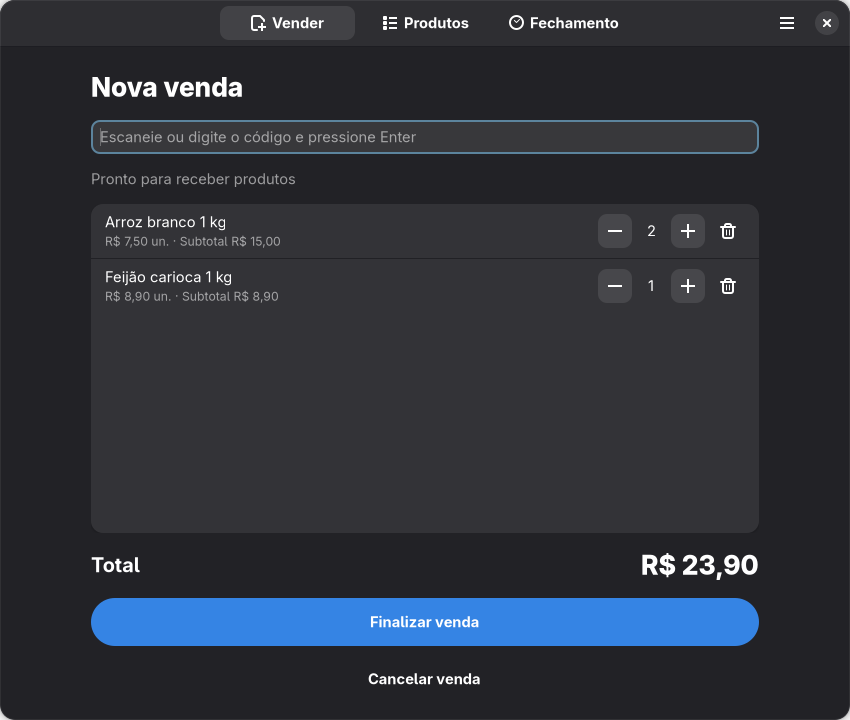

# Bipe

Um caixa simples para pequenos comércios.

Cadastre produtos, registre vendas e imprima comprovantes em um aplicativo nativo para GNOME. O Bipe funciona sem internet e mantém os dados no seu computador.

## Instalação

[Instalar o Bipe](https://ricardo-pompeu.github.io/bipe/Bipe.flatpakref)

Abra o arquivo na loja de aplicativos do Linux e confirme a instalação. As próximas atualizações ficam disponíveis pela mesma loja.

O pacote é para Linux de 64 bits, em computadores Intel ou AMD, com suporte a Flatpak. Consulte o [guia de instalação](INSTALACAO.md) se precisar de ajuda ou quiser trazer os dados de outra máquina.

## Impressão

O Bipe imprime comprovantes não fiscais e permite salvá-los em PDF.

Para usar uma POS-80 USB, o [kit de instalação](https://github.com/ricardo-pompeu/bipe/releases/latest/download/Bipe-POS80-linux-x86_64.tar.gz) inclui a configuração da impressora. Veja as [instruções para a POS-80](INSTALACAO.md#instalação-automática-com-a-pos-80-usb).

## Desenvolvimento

Feito com Python, GTK 4, Libadwaita e SQLite. As instruções para executar, testar e empacotar estão no [guia técnico](docs/GUIA-TECNICO.md).

Distribuído sob a licença [GPL-3.0-or-later](LICENSE).
